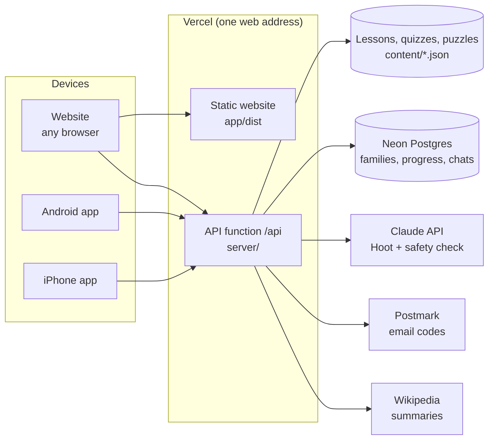

# 3. The project explained

Everything about Honest Learn in one place: what it is, the rules it lives by, how the pieces fit together, and how each important feature works. No programming knowledge is needed for the first half; the second half has the technical detail for developers.

## What it is

Honest Learn is a free learning app for children aged 3 to 18. It runs as a website and as Android and iPhone apps. For each age it covers the "minimum knowledge" a child should have across 11 subjects, using short lessons, quizzes that teach instead of test, brain puzzles, links to the best free resources, and an AI helper called **Hoot** that gives hints but never answers.

## The rules it lives by

These are built into the code, not just promised.

1. **Help, never cheat.** The app never receives a quiz answer before the child has earned it. Hints come in three steps: a nudge, a bigger hint, then a worked example of a *different* problem. Hoot is instructed and double-checked never to give answers.
2. **Parents in control.** Only a parent can create the account. A PIN guards settings, sensitive topics, chat history, outside links (under 13), extra screen time, data export and deleting the account.
3. **Sensitive topics stay hidden** (religion, body, politics) until a parent unlocks them, and are taught descriptively, from several perspectives.
4. **No ads, no tracking, no selling data, no streaks or leaderboards.** Nothing designed to keep a child hooked; daily time limits instead.
5. **Honest about quality.** Every lesson shows whether teachers have reviewed it. Nothing is called "reviewed" until two humans approve it.
6. **Right for the age.** Five age groups with different text sizes, colours, lesson lengths and features (for example, no Hoot under 6; "Read it to me" for the youngest).

## The pieces



| Piece | What it does | Folder |
|---|---|---|
| **App** | Everything people see and tap. One codebase (Expo / React Native) builds the website, the Android app and the iPhone app. | `app/` |
| **API server** | The brain: accounts, PIN, which lessons a child may see, checking answers, giving hints, Hoot, screen time, parent reports. Keeps every answer secret. | `server/` |
| **Content** | The curriculum as plain JSON files: the knowledge map, 175 lessons, 68 puzzles, 27 free resources, helplines, Hoot safety tests. Loaded by the server when it starts. | `content/` |
| **Database** | Families, children, progress, chats and settings. SQLite on a computer; Postgres (Neon) when deployed. | created automatically |
| **Outside services** | Claude (Hoot, optional), Postmark (email, at launch), Wikipedia (summaries for 9+), YouTube privacy-enhanced player (videos). | — |

## How the main features work

### Signing in: two keys
- When a parent signs up or signs in on a device, the device gets a **family key** (a signed token, valid 30 days). Children use the app with it.
- Entering the **PIN** gives a short **parent key** (10 minutes) for the parent area. The parent area locks itself when it expires.
- Every account has a **session version**. "Sign out all other devices" and password resets raise it, which instantly cancels every older key.

### Lessons
A lesson is a JSON file such as `content/lessons/b3/math/b3-math-comparing-fractions.json`:

```json
{
  "id": "b3-math-comparing-fractions",
  "title": "Which Fraction Is Bigger?",
  "band": "b3",                    // age group: b1 3–5, b2 6–8, b3 9–11, b4 12–14, b5 15–18
  "subject": "math",
  "outcomes": ["b3-math-2"],       // which knowledge-map outcomes it teaches
  "sensitive": null,               // or "religion" / "body" / "politics"
  "minutes": 15,
  "status": "draft",               // "reviewed" only after two human reviewers
  "reviewers": [],
  "sources": [{ "title": "OpenStax Prealgebra 2e", "url": "…", "license": "CC BY 4.0 (reference)" }],
  "sections": [
    { "type": "text",  "body": "A fraction like 3/4 means 3 parts out of 4 equal parts…" },
    { "type": "tryit", "body": "…" }   // also: "fact", "parent" (for grown-ups), "video"
  ],
  "quiz": [{
    "q": "Which is bigger: 5/6 or 3/4?",
    "options": ["5/6", "3/4", "They are equal"],
    "answer": 0,                   // the correct option is always written first
    "hints": ["nudge", "bigger hint", "worked example of a different problem"],
    "explain": "5/6 = 10/12 and 3/4 = 9/12 …"
  }]
}
```

When a child opens a lesson, the server sends the text and the questions **without** `answer`, `hints` or `explain`, and with the options **shuffled for that child**. (The shuffle is fixed per child, so it's the same each visit, but two friends see different orders.)

### The quiz and the hint ladder
1. The child picks an option; the app asks the server "is this right?" (`/check`).
2. If not, they can open **hint 1**, then **hint 2**, then **hint 3** (`/hint`). The server records each one and refuses to skip ahead.
3. The explanation appears after a correct answer. If they're still stuck after all three hints, the server shows the answer *with* the explanation, so they learn it rather than guess.
4. Only **first tries** count for the score. A perfect lesson earns a ⭐.
5. The lesson comes back for a short review after 1 day (if anything was wrong) or 3, 6, 12… days (spaced repetition).

### Hoot, the AI helper
- For ages 6+, and only if the parent allows it. Up to 40 messages per child per day.
- Before any AI call, a **pre-check** catches personal information ("my address is…") and wellbeing messages ("I want to hurt myself"). It answers with a fixed, safe reply and, for wellbeing, a helpline for the family's country. The message is flagged for the parent.
- Otherwise Claude writes a reply as a patient tutor that asks questions and gives hints. A **second, independent check** then reviews the reply for safety and for leaking the answer. If it fails, the child gets the lesson's pre-written hint instead.
- Personal information is never stored as typed. Parents can read every chat. Chats are deleted after a year.
- Without a Claude API key, Hoot runs in **mock mode** and answers with the lesson's own hints, so everything works for testing.

### Age groups
| Group | Ages | Text | Special |
|---|---|---|---|
| Little Explorers (b1) | 3–5 | Largest, rounded | "Read it to me", no Hoot, no search |
| Early Learners (b2) | 6–8 | Large | "Read it to me", Hoot if allowed, no search |
| Discoverers (b3) | 9–11 | Medium | Search, Simple English Wikipedia |
| Thinkers (b4) | 12–14 | Normal | Wikipedia |
| Builders (b5) | 15–18 | Normal | Careers & College Prep subject |

Outside websites need the parent PIN under 13; teens see a "you're leaving Honest Learn" notice.

### Screen time
The app reports one minute at a time while a child is actively learning; the server counts it (once per 50 seconds at most), so the daily limit holds across every device. Parents can give extra minutes for today with the PIN.

### Offline
Lessons a child has opened are saved on the device (without answers), so they can be read without internet. Answers are checked when the connection returns; finished lessons and minutes are sent then. The website can be installed to the home screen and opens offline.

### Pre-launch mode vs launch
Until the setting `LAUNCH=true`, the server runs in **pre-launch mode**: draft lessons are shown, email verification is off, email codes go to the server log, and a sign-in secret is generated automatically. This lets the site run on Vercel with **zero settings** for testing and review. `LAUNCH=true` switches to strict defaults (drafts hidden, verification on, real email required).

## Technical detail (for developers)

### Stack
| Layer | Technology |
|---|---|
| App | Expo SDK 58, React Native 0.88, expo-router (file-based routes in `app/src/app`), TypeScript |
| API | Node 22, Hono 4, zod validation, TypeScript run by tsx (no build step) |
| Database | `node:sqlite` locally; Neon Postgres over HTTPS when `DATABASE_URL` is set; in-memory demo database on Vercel without one. One async interface (`server/src/db.ts`), portable SQL |
| AI | Claude API (`claude-opus-5-5` by default for replies and the safety check; configurable) |
| Hosting | Vercel: static site from `app/dist`, API as one function under `/api` |
| Tests | node:test: API tests on SQLite and on Postgres (PGlite), safety tests, legal-text sync, header sync |
| CI | GitHub Actions: content validation, generated-file freshness, typecheck, tests (SQLite + Postgres), app lint and web build |

### API layout (`server/src/`)
| File | Responsibility |
|---|---|
| `app.ts` | Creates the API: shared protections (CORS, security headers, size limit, no-store), sign-in requirements per path, mounts the route modules |
| `context.ts` | Shared helpers: sign-in check, lesson visibility, hint ladder records, attempt limits, email codes |
| `models.ts` | Database row types, input rules, child helpers, spaced-repetition interval |
| `routes/public.ts` | `/health`, `/content/map`, `/content/countries` |
| `routes/auth.ts` | `/auth/signup`, `login`, `verify-email`, `resend-verification`, `forgot-password`, `reset-password`, `reset-pin`, `parent-unlock` |
| `routes/learn.ts` | `/family`, `/children/:id/home`, `lessons`, `lessons/:lessonId` (+ `/hint`, `/check`, `/complete`, `/learn-more`), `resources`, `practice` |
| `routes/puzzles.ts` | `/children/:id/puzzles` (+ `/hint`, `/check`, `/complete`) |
| `routes/usage.ts` | `/children/:id/usage`, `/usage/tick` |
| `routes/tutor.ts` | `/children/:id/tutor/:lessonId` (Hoot), `/reports` |
| `routes/parent.ts` | `/parent/overview`, `children` (add, edit, delete, bonus time, chats), `reports`, `pin`, `settings`, `sign-out-everywhere`, `export`, `account` |
| `tutor.ts` | Hoot: pre-checks, Claude prompt, the second safety check, mock mode |
| `content.ts` | Loads and validates `content/`, strips answers for the app |
| `shuffle.ts` | Per-child option order |
| `wiki.ts` | Wikipedia summaries (fixed titles only, cached a day) |
| `mailer.ts` | Postmark, console or in-memory (tests) |
| `db.ts`, `db-neon.ts`, `open-db.ts` | Database adapters, schema and migrations, data retention |
| `security.ts` | Hashing, tokens, age groups |
| `web-headers.ts` | Website security headers (shared with `vercel.json`) |
| `index.ts`, `preview.ts`, `vercel.ts` | Ways to run it: API only (`npm run dev`), website + API on one port, Vercel function |

### Data (tables)
| Table | Holds |
|---|---|
| `parents` | Email, password and PIN hashes, lock counters, email-verified time, country, session version, consent |
| `children` | Nickname, birth year, avatar, age-group override, unlocked topics, Hoot on/off, daily minutes |
| `progress` | Best score, attempts, review date per child and lesson (also puzzle sets) |
| `quiz_solved` | Questions a child answered correctly (Hoot may then explain them) |
| `hints_seen` | Highest hint opened per child and question (the answer-reveal rule) |
| `tutor_messages` | Hoot chats (flagged ones marked) |
| `auth_codes` | Hashed email codes |
| `usage` | Minutes and bonus minutes per child per day |
| `reports` | "Report a problem" submissions |
| `app_settings` | The generated sign-in secret (pre-launch / zero-config) |

Deleting a parent deletes everything about the family (cascading deletes). Old chats, usage and closed reports are purged automatically.

### The app (`app/src/`)
| Folder | Holds |
|---|---|
| `app/` | Screens, one file per route: `welcome`, `signup`, `login`, `forgot`, `reset-pin`, `privacy`, `terms`, `profiles`, `learn/[childId]/…` (home, subject, lesson, practice, puzzles, tutor), `parent/…` (overview, add-child, child settings, chats) |
| `components/` | Shared UI: buttons, cards, progress bars (`ui.tsx`), the quiz runner, PIN pad, video player, outside-link guard, report sheet, country picker |
| `lib/` | API client, session (tokens), offline cache and sync, storage, theme (colours per age group, all WCAG AA), screen-time timer, PWA registration |

### Content pipeline
1. Write or edit JSON in `content/` following [`docs/REVIEWER_GUIDE.md`](../REVIEWER_GUIDE.md), with `"status": "draft"`.
2. `cd server && npm run validate` checks every file and warns when a hint seems to give the answer away.
3. Run the three generators (README catalogue, review spreadsheets, knowledge-map document). CI fails if they're stale.
4. Two reviewers approve → `"status": "reviewed"` with their names.

### Testing and quality
- `cd server && npm test` (SQLite) and `npm run test:pg` (Postgres): 62 tests covering accounts, PIN, lessons, the hint ladder, shuffling, Hoot safety, screen time, data rights, security hardening and deployment defaults.
- `cd app && npx tsc --noEmit && CI=1 npx expo lint`.
- Every push runs all of it on GitHub Actions.

### Security
See [`docs/SECURITY.md`](../SECURITY.md) for the full model, the latest review and what's still open.
