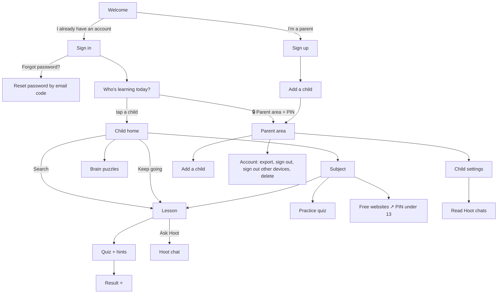

# 4. How to navigate

Four maps: the **app** (screens), the **repository** (files), the **documents**, and the **online dashboards** (GitHub, Vercel, Neon).

## The app



### As a parent
1. **Welcome → "I'm a parent — create an account."** Email, password, a 4–6 digit PIN, optional country. You land in the parent area to add your first child.
2. **Add a child:** nickname (a nickname is safest), birth year, an animal avatar.
3. **Parent area** (from the profile screen: *🔒 Parent area* + PIN). It locks itself after 10 minutes.
   - Each child's card shows this week, lessons done, quiz score, puzzles, Hoot on/off, daily minutes and per-subject progress bars. Tap a card for that child's **settings**.
   - **Child settings:** nickname, learning level (match age, or choose another group), sensitive topics (religion, body, politics), Hoot on/off, daily minutes, *Read chats* (Hoot history), *Delete this profile*.
   - **Extra time:** when a child's time is up, their screen offers "+15 minutes" for a grown-up with the PIN.
   - **Country:** for helpline information in Hoot's safety replies.
   - **Account:** download all data, lock the parent area, sign out of this device, **sign out all other devices**, delete the account.
4. **Back to learning →** returns to "Who's learning today?".

### As a child
1. **Who's learning today?** Tap your avatar.
2. **Home:** your progress (lessons, ⭐ stars, minutes left today), the **Keep going** card, **search** (ages 9+), **Brain puzzles**, then your **subjects**.
3. **Subject:** its lessons (⭐ = all right first time, ✅ = done, ✏️ = still being checked by teachers), a **practice quiz**, and **more free learning** websites.
4. **Lesson:** read (or *Read it to me* for ages 3–8), then **Let's play the quiz!** Stuck? **💭 I need a hint**, up to three. *🦉 Ask Hoot* opens the helper (ages 6+, if allowed).
5. **⚑ Report** on any lesson sends a problem to the team.

### Web addresses
On the website every screen has an address, for example `/welcome`, `/profiles`, `/parent`, `/learn/<child>/subject/math`, `/learn/<child>/lesson/<lesson-id>`. The API is under `/api` (try `/api/health`).

## The repository

### "I want to… → go to…"

| I want to… | Go to |
|---|---|
| Read or change a **lesson** | `content/lessons/<age>/<subject>/<lesson-id>.json` (ages: `b1` 3–5 … `b5` 15–18) |
| Find which lesson teaches an **outcome** | `docs/KNOWLEDGE_MAP.md` (readable) or `content/knowledge-map.json` |
| Change **brain puzzles** | `content/puzzles/b1.json` … `b5.json` |
| Add or remove a **free website** | `content/resources.json` |
| Check **helpline** numbers | `content/helplines.json` |
| See **everything in the app** at a glance | `README.md` → "What's inside" |
| See **what needs human approval** | `docs/NEEDS_APPROVAL.md` and GitHub issue #1 |
| Change **wording on a screen** | `app/src/app/<screen>.tsx` (e.g. `welcome.tsx`, `parent/index.tsx`, `learn/[childId]/index.tsx`) |
| Change **colours, fonts, subject icons** | `app/src/lib/theme.ts` |
| Change **buttons, cards, progress bars** | `app/src/components/ui.tsx` |
| Change how **quizzes and hints** behave | `app/src/components/QuizRunner.tsx`, `app/src/app/learn/[childId]/lesson/[lessonId].tsx`, `server/src/routes/learn.ts` |
| Change **Hoot's** personality or safety | `server/src/tutor.ts` (prompts, pre-checks), tests in `server/test/safety.test.ts`, red-team cases in `content/hoot-redteam.json` |
| Change **who can see what** | `server/src/context.ts` (`visibleTo`, `requireScope`) |
| Change **limits** (PIN tries, token lifetimes, Hoot messages per day) | `server/src/config.ts` |
| Add an **API endpoint** | the matching file in `server/src/routes/`, plus a test in `server/test/api.test.ts` |
| Change the **database** | `server/src/db.ts` (new tables in `TABLES`, new columns in `MIGRATIONS`) |
| Change **privacy notice or terms** | `docs/legal/*.md`, then `node scripts/build-legal.mjs` (updates the in-app copy) |
| Change **deployment** | `vercel.json`, `api/index.ts`, `server/src/vercel.ts`, `docs/DEPLOYMENT.md` |
| Change **website security headers** | `server/src/web-headers.ts` **and** `vercel.json` (a test checks they match) |
| See what runs on **every push** | `.github/workflows/ci.yml` |

### Folder tree

```
honest-learn/
├── app/                         the app (website + Android + iPhone)
│   ├── src/app/                 screens: one file per screen (expo-router)
│   │   ├── welcome, signup, login, forgot, reset-pin, privacy, terms, profiles
│   │   ├── learn/[childId]/     child home, subject, lesson, practice, puzzles, tutor (Hoot)
│   │   └── parent/              parent area, add child, child settings, chats
│   ├── src/components/          shared building blocks (ui, QuizRunner, PinPad, VideoEmbed…)
│   ├── src/lib/                 api client, session, offline, storage, theme, timer
│   ├── public/                  website extras: manifest, service worker, icons
│   ├── assets/                  app icons and splash screen
│   ├── app.json, eas.json       app-store settings and build profiles
│   └── scripts/check-contrast.mjs   checks colours meet accessibility contrast
├── server/                      the API
│   ├── src/app.ts               wires everything together
│   ├── src/routes/              one file per area: public, auth, learn, puzzles, usage, tutor, parent
│   ├── src/context.ts           shared helpers (sign-in, hint ladder, limits, email codes)
│   ├── src/models.ts            data shapes and input rules
│   ├── src/tutor.ts             Hoot
│   ├── src/content.ts           loads content/
│   ├── src/db*.ts               databases (SQLite, Postgres), schema, migrations
│   ├── src/index.ts | preview.ts | vercel.ts    the three ways to run it
│   └── test/                    automated tests
├── content/                     the curriculum (see above)
├── docs/                        documents (see below)
├── scripts/                     generators and checkers
├── api/index.ts                 Vercel's entry point for the API
├── vercel.json                  Vercel build, routes and headers
├── package.json                 root commands: npm run dev / build:web / preview
├── README.md                    the front page
└── CLAUDE.md                    instructions for Claude Code
```

### Everyday commands

```bash
npm run dev                          # from the top folder: install, build the website, serve it + the API on :3000
```

```bash
cd server && npm test                # run the API tests
```

```bash
cd server && npm run validate        # check all content
```

```bash
node scripts/build-catalogue.mjs && node scripts/export-review-sheet.mjs && node scripts/build-knowledge-doc.mjs   # after changing content
```

## The documents

| Read this | When |
|---|---|
| [`docs/README.md`](../README.md) | Start here: the index of every document |
| [Guide 1–5](README.md) | Understanding the project (this set) |
| [`docs/NEEDS_APPROVAL.md`](../NEEDS_APPROVAL.md) | Before launch: what experts must check |
| [`docs/REVIEWER_GUIDE.md`](../REVIEWER_GUIDE.md) | Writing or reviewing lessons |
| [`docs/KNOWLEDGE_MAP.md`](../KNOWLEDGE_MAP.md) | What each age should know (generated) |
| [`docs/DEPLOYMENT.md`](../DEPLOYMENT.md) | Putting it online, settings, app-store builds |
| [`docs/LAUNCH_CHECKLIST.md`](../LAUNCH_CHECKLIST.md) | Everything to finish before the public launch |
| [`docs/SECURITY.md`](../SECURITY.md) | How families are protected; the security review |
| [`docs/HOOT_SAFETY_TESTS.md`](../HOOT_SAFETY_TESTS.md) | Testing Hoot against misuse |
| [`docs/RESEARCH_USER_FEEDBACK.md`](../RESEARCH_USER_FEEDBACK.md) | What users of other apps praise and complain about |
| [`docs/legal/`](../legal/) | Draft privacy notice and terms (need a lawyer) |
| [`docs/review/*.csv`](../review/) | Spreadsheets of every lesson and question for reviewers |

## Online dashboards

| Where | What to look at |
|---|---|
| **GitHub → Code** ([link](https://github.com/PHANI465/honest-learn)) | Browse and even edit files in the browser (pencil icon → *Commit changes*). The README shows the full catalogue. |
| **GitHub → Issues** | Issue #1 tracks expert approvals. Add new issues for bugs and ideas. |
| **GitHub → Actions** | The checks run on every push. A green tick means content, tests and the build all pass. |
| **GitHub → Commits** | The full history: who changed what and when. |
| **Vercel** (vercel.com, once imported) | *Deployments* (each push builds a new version; open one for its logs), *Storage* (connect Neon), *Settings → Environment Variables* (`LAUNCH`, `ANTHROPIC_API_KEY`…), *Logs* (errors, and email codes before launch). |
| **Neon** (via Vercel *Storage*, or neon.tech) | The database: tables, usage, backups and restore. |
| **Expo** (expo.dev, when building phone apps) | Android and iPhone builds and store submissions. |
